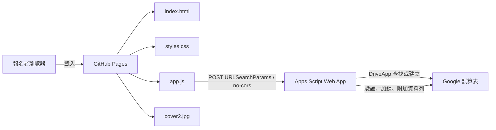

# 系統架構

## 概觀

網站是無建置步驟的靜態前端，由 GitHub Pages 提供；報名資料經 Apps Script Web App 寫入 Google 試算表。

## 網頁版面

頁面由上而下包含三列：

1. 活動標題及報名錨點。
2. 圓角橫幅圖片 `cover2.jpg`。
3. 活動內容與報名表單；寬螢幕左右排列，窄螢幕改為單欄堆疊。

行程內容為 08:00 報到、09:00 場次一、10:00 break time、10:30 場次二、11:30 Q&A、12:00 活動結束。

## 檔案責任

| 檔案 | 用途 |
| --- | --- |
| `index.html` | 頁面語意結構、行程、欄位標籤與必填驗證。 |
| `styles.css` | 桌機與手機版面、色彩、表單狀態及動態效果。 |
| `app.js` | 表單送出、前端狀態訊息及 Apps Script URL。 |
| `Code.gs` | Apps Script 入口、欄位驗證、併發鎖、試算表初始化與資料寫入。 |
| `cover2.jpg` | 網站目前使用的活動橫幅圖片。 |
| `cover.jpg` | 舊圖片檔，保留但不由網站引用。 |
| `README.md` | 專案首頁及正式 Pages 網址。 |
| `spec/` | 原始需求文件；不應提交到 GitHub。 |

前端以 Google Fonts 載入 `DM Sans` 與 `Noto Sans TC`。專案沒有 npm、打包器或建置指令。

## 報名資料契約

前端表單欄位及送給 Apps Script 的參數如下：

| 顯示名稱 | 參數名稱 | 必填 | 試算表欄位 |
| --- | --- | --- | --- |
| 姓名 | `name` | 是 | 姓名 |
| Email | `email` | 是 | Email |
| 單位 | `department` | 否 | 單位 |
| 電話 | `phone` | 是 | 電話 |
| 職稱 | `title` | 否 | 職稱 |

前端使用 `URLSearchParams` 以 POST 傳送。Apps Script 由 `event.parameter` 讀取內容，去除字串前後空白後寫入一列。必要欄位缺漏時回傳 `{ "ok": false, "message": "缺少必填欄位" }`；成功時回傳 `{ "ok": true }`。

`app.js` 使用 `mode: "no-cors"`，瀏覽器無法讀取 Apps Script 回應本文或 HTTP 狀態。前端顯示成功代表請求已送出且網路呼叫未拋出例外，不是後端資料庫寫入的端到端確認。驗收及故障排查應同時查看 Apps Script 執行記錄與試算表。

## 試算表結構

- 試算表名稱：`2026_公司旅遊`。
- 使用試算表中的第一個工作表。
- 空白工作表初始化時建立標題列：`姓名`、`Email`、`單位`、`電話`、`職稱`，並凍結第一列。
- 電話位於 D 欄。初始化時將整欄格式設為純文字；每次新增資料後也將該筆電話儲存格格式設為 `@`，保留 `0`、`+` 等電話字元。
- `DriveApp.searchFiles` 以試算表 MIME 類型與標題搜尋，避免同名 Apps Script 專案被誤認為試算表。
- `LockService.getScriptLock()` 避免同時送出時取得相同的下一列；等待鎖定最長 10 秒。

## 權限與資料邊界

GitHub Pages 網站為公開靜態頁面。Apps Script Web App 設為「以專案擁有者身分執行」及「所有人可存取」，因此未登入者可提交資料，而試算表操作使用擁有者權限。姓名、Email、單位、電話、職稱是個人資料；試算表權限應維持在必要維護人員範圍，不要將試算表設為公開。

公開 Apps Script endpoint 沒有登入、驗證碼或頻率限制；若報名入口遭濫用，應加上存取控管或防濫用措施，並同步調整前端提交流程。